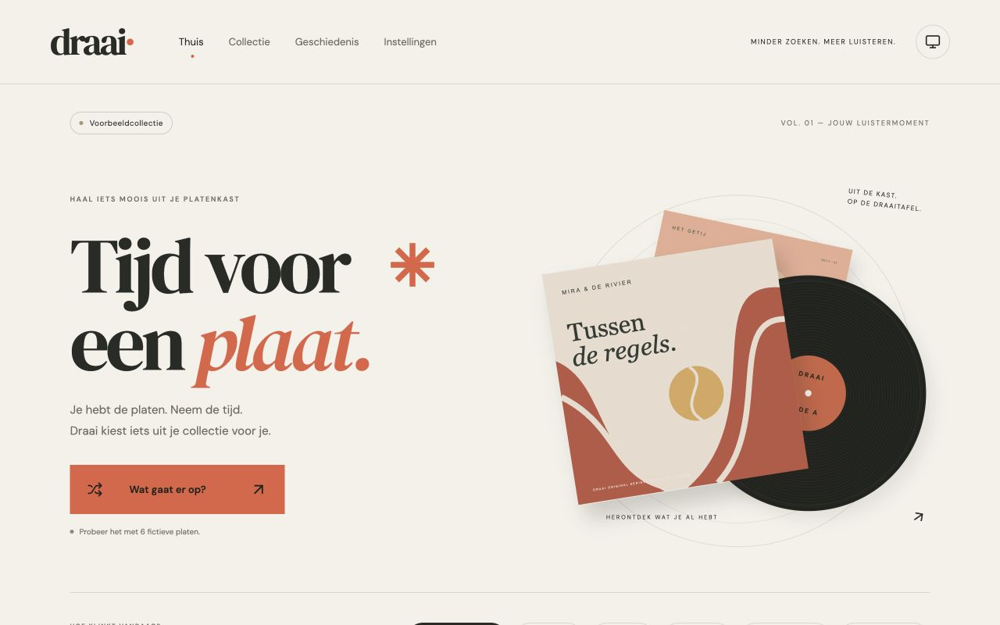
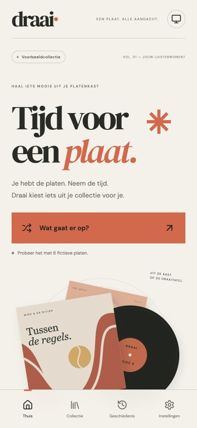

# Draai

Je hebt de platen. Draai helpt je kiezen wat er op gaat. Deze zelf te hosten webapp haalt je vinylcollectie uit Discogs en werkt op je telefoon, tablet of computer. Kies een stemming, bekijk een voorstel en bevestig zelf je luistersessie. Draai bewaart je sessies en notities, zodat je kunt terugzien wat je hebt geluisterd.





De screenshots tonen de fictieve voorbeeldcollectie; er zijn geen persoonlijke collectiegegevens afgebeeld. Draai is een zelf te hosten hobbyproject en is niet verbonden aan Discogs.

## Wat je ermee kunt

- Platen kiezen op stemming, met instelbare verbanden voor 91 stijlen en 13 genres. Je eigen plaatlabels gaan vóór stijlverbanden, stijlen vóór genres.
- Inzicht in stijlen zonder stemmingsverband, met aantallen en direct bewerkbare regels.
- Dagelijks wisselende hoezen om je collectie opnieuw te ontdekken.
- Luistersessies handmatig bevestigen en bewaren, met notities en statistieken over geregistreerde sessies.
- Optioneel gemeten weer van Weather Underground gebruiken in zelf ingestelde selectieregels, met eigen koud-/warmtegrenzen.
- Optioneel albumverhalen en muziekkalenderinformatie tonen via exacte Discogs-ID-koppelingen met Wikidata en Wikipedia. Deze functie staat standaard uit.
- Een sessie tonen op een tweede scherm via `/display` (kioskweergave).

Draai speelt geen muziek af en detecteert geen audio, nummers of draaitafel. Sessieduur is geen gemeten afspeeltijd.

## Lokale demo

Vereist Node.js 24 en pnpm 11.25.0. De `.env.example` start met fictieve demodata.

```sh
git clone https://github.com/Roeltje/draai.git
cd draai
pnpm install --frozen-lockfile
cp .env.example .env
pnpm dev
```

Open de lokale URL die de ontwikkelserver toont. Zonder Discogs-token werkt de demo; demo en eigen collectie gebruiken gescheiden databases. Voor je eigen Discogs-collectie kun je lokaal `DISCOGS_USERNAME` en `DISCOGS_TOKEN` instellen in `.env`. Optionele integraties zijn `WU_API_KEY` met `WU_STATION_ID`, en `WIKI_ENABLED=true`. Herstart na configuratiewijzigingen. Houd sleutels en `.env` privé: deze waarden worden alleen door de server gebruikt.

## Zelf hosten

De aanbevolen installatie is een niet-geprivilegieerde Proxmox LXC met Ubuntu 24.04 of 26.04. Zie de [installatiehandleiding](docs/INSTALLATIE.md#proxmox-lxc-aanbevolen-installatie) en de aparte [handleiding voor bijwerken](docs/UPDATEN.md). Een gebruiker heeft installatie en bijwerken op Ubuntu 26.04 bevestigd. De Raspberry Pi-weergave is nog niet op echte hardware getest.

Draai heeft geen ingebouwde login of toegangsbeheer. Gebruik het op een vertrouwd LAN of via VPN, of zet een beveiligde authenticatieproxy ervoor. HTTPS alleen beveiligt de verbinding maar voegt geen login toe. Stel de app niet rechtstreeks open aan het internet. Bewaar tokens in de serverconfiguratie (`.env` of `/etc/draai.env`), nooit in browsercode of een publieke repository. Zie ook [veilig gebruik](SECURITY.md).

## Licentie en gegevens

De broncode is beschikbaar onder de [MIT-licentie](LICENSE). Externe gegevens en diensten, waaronder Discogs, Wikipedia/Wikidata en Weather Underground, vallen onder hun eigen voorwaarden en licenties. Draai toont bronvermelding waar van toepassing; de MIT-licentie geldt niet voor die externe gegevens.

## Meedenken en ontwikkelen

Ideeën en fouten kun je melden via [GitHub Issues](https://github.com/Roeltje/draai/issues). Beschrijf wat je verwachtte en wat er gebeurde; deel geen tokens, configuratiebestanden of persoonlijke database. Zie [de backlog](docs/TODO.md) voor plannen en [de verificatie](docs/VERIFICATIE.md) voor uitgevoerde controles.

Ontwikkelcommando’s: `pnpm check` voor typecontrole, `pnpm test` voor tests en `pnpm build` voor de productiebuild. Daarna start `pnpm start` de app op poort 3210. Docker, pushmeldingen en audioherkenning zijn nog niet beschikbaar.
